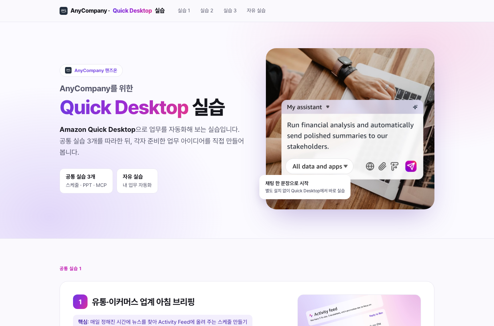

# quick-desktop-guide

고객사별 **Amazon Quick Desktop 실습 가이드** 템플릿과, 이를 고객사마다 다시 만드는 Claude Code 스킬입니다.

템플릿 이름은 "AnyCompany를 위한 Quick Desktop 실습"입니다. 고객사 이름·로고와 실습 1 시나리오만 바꾸고, 회의실 MCP를 배포해 실습 3을 채우면 그대로 실습을 진행할 수 있습니다.



완성된 모습은 [`examples/anycompany/index.html`](examples/anycompany/index.html)에서 볼 수 있습니다 (가상 유통 회사 AnyCompany 용으로 실습 1을 새로 쓰고 실습 3을 채운 예시, 값은 가상).

## 실습 구성

| 실습 | 내용 | Quick Desktop 기능 | 화면 자료 |
|---|---|---|---|
| 1 | 매일 아침 뉴스 3개 요약 → Activity Feed | 스케줄, 웹 검색 | Activity Feed 이미지 |
| 2 | 외식 프랜차이즈 광고 트렌드 PPT (찾은 소식으로 만든 수정 가능한 차트 4장) | 웹 검색, PPT 생성 | 만드는 과정 영상, 완성본 영상 |
| 3 | 회의실 예약 MCP 연결 후 채팅으로 예약 | MCP (Remote › Paste JSON) | 연결 영상, 회의실 현황 페이지 |
| 자유 | 기능 목록, 웹 커넥터(Gmail, Google Sheets 등) 연결 | 웹 커넥터 | 연결 영상 |

- **실습 1**은 고객사마다 프롬프트가 달라야 합니다. 템플릿에는 범용 기본 시나리오("AI·IT 업계 주요 뉴스")가 들어 있고, 스킬이 고객사에 맞는 시나리오를 새로 씁니다.
- **실습 3**의 회의실 MCP는 아래 레포로 배포합니다.

## 실습 3 회의실 MCP: [ottlseo/meeting-room-mcp](https://github.com/ottlseo/meeting-room-mcp)

CloudFormation 한 번으로 회의실 예약 MCP 서버(AgentCore Gateway + Lambda + DynamoDB)와, 그 MCP와 연결된 회의실 현황 페이지(CloudFront)를 배포합니다. 배포가 끝나면 `mcp.json`과 현황 페이지 주소가 출력되고, 이 두 값을 가이드 실습 3에 넣습니다.

```bash
git clone https://github.com/ottlseo/meeting-room-mcp.git
cd meeting-room-mcp
./scripts/deploy.sh --prefix <slug>-room --region us-east-1   # mcp.json, room status page 출력
./scripts/mcp-json.sh --stack <slug>-room-mcp                  # 실습 당일 아침 토큰 재발급 (24시간)
./scripts/destroy.sh --prefix <slug>-room                      # 실습이 끝난 뒤
```

## 고객사 버전 만들기 (Claude Code 스킬)

```bash
git clone https://github.com/ottlseo/quick-desktop-guide.git
cd quick-desktop-guide
claude
```

Claude Code에서 이렇게 요청합니다.

```text
<고객사 이름>용 Quick Desktop 실습 가이드 만들어줘. 홈페이지는 <URL> 이야.
```

`.claude/skills/quick-desktop-guide/SKILL.md`가 아래 순서로 진행합니다.

1. 고객사 표기, 로고, 하는 일, AWS 계정·리전, 실습 날짜를 확인
2. `guide/`를 `out/<slug>/`로 복사하고 이름·로고 교체
3. **실습 1 시나리오를 고객사에 맞게 새로 작성** (후보 2~3개를 보여주고 고르게 함)
4. 회의실 MCP 배포 후 실습 3에 `mcp.json`과 현황 페이지 주소 반영
5. 자리표시·em dash 기호·CSS·화면 깨짐 확인
6. CloudFront로 올리기 (`scripts/publish.sh`)

## 직접 만들 때

1. `guide/`를 복사해 `AnyCompany`를 고객사 이름으로, `assets/company-logo.png`(기본값은 AWS 로고)를 고객사 로고로 바꿉니다.
2. 실습 1 프롬프트(`#p1`)를 고객사에 맞게 바꿉니다. 스케줄 + 웹 검색 + Activity Feed 구조를 지키고, 출처 링크로 확인되는 주제를 고릅니다.
3. [meeting-room-mcp](https://github.com/ottlseo/meeting-room-mcp)를 배포하고, 출력된 `mcp.json`으로 `<pre id="p3">`를, 현황 페이지 주소로 `{{ROOMS_PAGE_URL}}`을 바꿉니다.
4. 브라우저로 열어 확인하거나 아래처럼 올립니다.

## 올리기와 지우기

```bash
./scripts/publish.sh --name anycompany --dir out/anycompany     # S3 + CloudFront, 다시 실행하면 파일만 갱신
./scripts/unpublish.sh --name anycompany                         # 실습이 끝난 뒤
```

실습 3 설정에는 24시간 토큰이 들어갑니다. 실습 당일 아침에 meeting-room-mcp의 `./scripts/mcp-json.sh`로 토큰을 다시 받아 가이드에 넣고 `publish.sh`를 다시 실행하세요. 실습이 끝나면 가이드와 회의실 MCP를 모두 지웁니다.

## 폴더

```
guide/index.html                         AnyCompany 템플릿 (실습 1~3 + 자유 실습)
guide/assets/                            이미지, 영상(mp4)과 대표 이미지, 로고(기본 AWS 로고), Quick 파비콘
examples/anycompany/index.html           완성 예시 (실습 1 고객사 맞춤, 실습 3 채움, 값은 가상)
.claude/skills/quick-desktop-guide/      고객사별 가이드를 만드는 Claude Code 스킬
hosting/template.yaml                    가이드 호스팅 (비공개 S3 + CloudFront OAC)
scripts/publish.sh, unpublish.sh         올리기, 지우기
docs/                                    README 이미지
```

## 영상

| 파일 | 길이 | 들어가는 곳 |
|---|---|---|
| `quick-ppt-generate.mp4` | 4분 53초 | 실습 2 만들어지는 과정 |
| `quick-ppt-results.mp4` | 42초 | 실습 2 완성된 PPT |
| `mcp-connect-guide.mp4` | 1분 29초 | 실습 3 MCP 붙여넣기 |
| `quick-connector-create.mp4` | 1분 20초 | 자유 실습 웹 커넥터 연결 |

모두 1600px, 30fps, 무음입니다. `mcp-connect-guide.mp4`에는 녹화할 때 쓴 다른 서버 이름이 화면에 보입니다. 고객사 이름이 보여야 하면 새로 녹화해서 같은 이름으로 바꿔 넣으세요.
